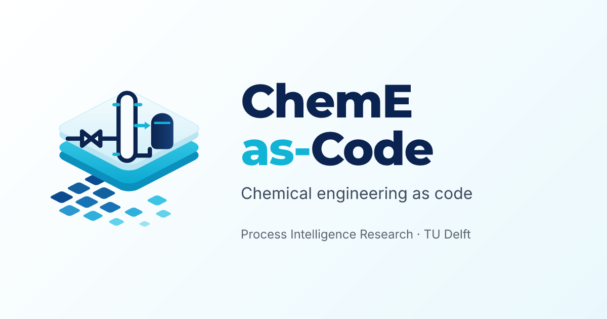
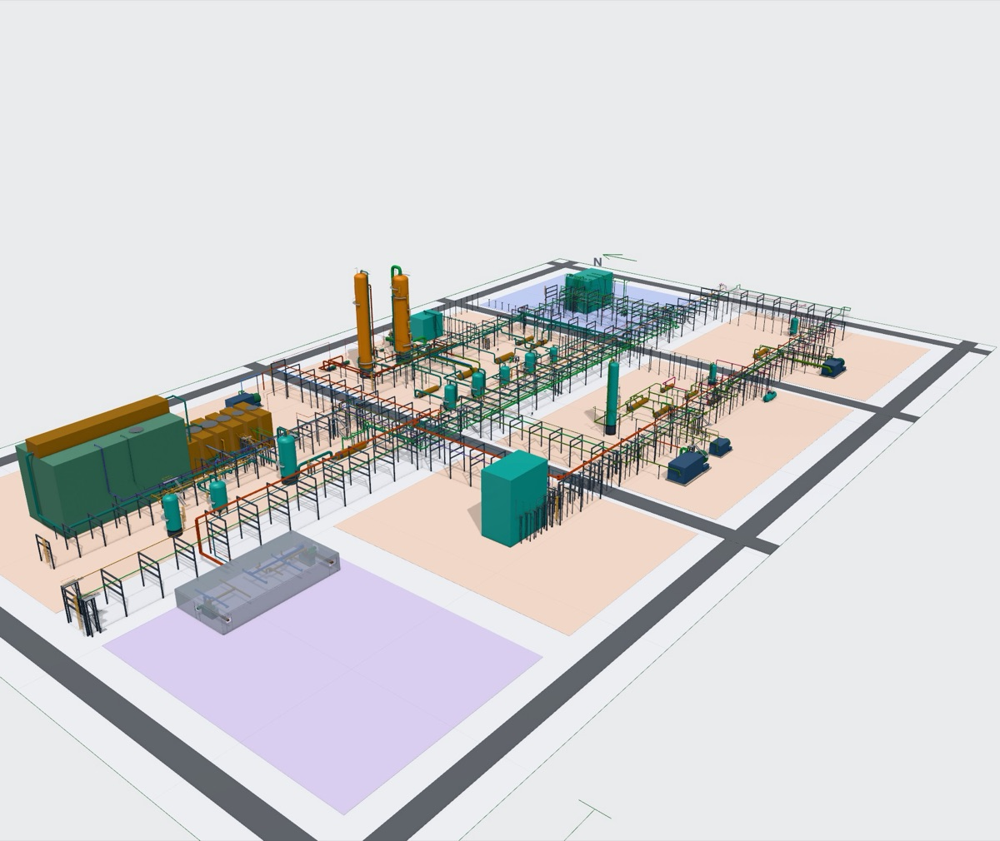

  

  <a href="https://cheme-as-code.org"><b>Website</b></a> ·
  <a href="https://atlas.cheme-as-code.org"><b>Process Atlas</b></a> ·
  <a href="https://docs.cheme-as-code.org"><b>Docs</b></a> ·
  <a href="https://cheme-as-code.org/paper/cheme-as-code-preprint.pdf"><b>Paper (preprint)</b></a>

# ChemE-as-Code

**An open-source platform for agentic AI in chemical engineering.** AI agents built on large
language models carry out chemical engineering work, and engineers check it. A plant is kept as
linked, machine-readable engineering files in git: P&IDs in DEXPI 2.0.1, engineering lists in
YAML, decisions in Markdown. Calculation tools, from catalysis through process simulation to plant
layout, HAZOP and life cycle assessment, run outside the language model; each value records where
it came from, and automated checks report inconsistencies and out-of-date results by file and line.

   
  The ammonia case study of the paper: agents developed a written task into a preliminary
  basic-engineering package. The 3D layout is generated from the plant's engineering files.

The designs in the [Process Atlas](https://atlas.cheme-as-code.org) were produced by AI agents
under human direction. They are research output, not engineering advice, and not approved for
construction, operation or safety decisions.

## What you can do with it

- **Draw and check P&IDs** as text: validation with file and line, a formatter that keeps diffs
  small, rendering and a visual diff between revisions.
- **Design the process**: block and process flow diagrams from YAML, stream tables with the
  source of every value, simulation in DWSIM, reactions, kinetics and reactors.
- **Lay out the plant in 3D**: equipment, pipe routes, steel, cable trays and ducts, with clash
  and access checks.
- **Assess it**: equipment datasheets and cost estimates, material take-off, techno-economic
  analysis and life cycle assessment.
- **Review it** in the browser with the read-only [Viewer](https://github.com/ChemE-as-Code/core/tree/main/viewer).

## Repositories

| | |
|---|---|
| [`core`](https://github.com/ChemE-as-Code/core) | the `cheme` command-line tool, the skills for AI agents and the web Viewer (`viewer/`) |
| [`project-template`](https://github.com/ChemE-as-Code/project-template) | an empty plant: press **Use this template** to start one |
| [`process-library`](https://github.com/ChemE-as-Code/process-library) | about 50 plant designs, one folder per process, and the life cycle inventories of the Process Atlas |

## Getting started

1. Install the tool: `uv tool install git+https://github.com/ChemE-as-Code/core.git`
2. Start a plant: **Use this template** on [`project-template`](https://github.com/ChemE-as-Code/project-template),
   or `cheme init my-plant`.
3. Work in it with your editor or a coding agent; run `cheme validate` after every change.

## The paper

Artur M. Schweidtmann. *ChemE-as-Code: An Open-Source Platform for Agentic AI in Chemical
Engineering.* Preprint, submitted to AIChE Journal, November 2026.
[Download the PDF](https://cheme-as-code.org/paper/cheme-as-code-preprint.pdf).

## Who we are

ChemE-as-Code is developed by the [Process Intelligence Research](https://www.pi-research.org/)
group at the Department of Chemical Engineering, Delft University of Technology, led by
[Artur M. Schweidtmann](https://www.pi-research.org/author/artur-schweidtmann/).

## Contributors

| | Name | Role |
|---|---|---|
|  | [Artur M. Schweidtmann](https://www.pi-research.org/author/artur-schweidtmann/) | ChemE-as-Code and Process Atlas (principal investigator) |
|  | Jana M. Weber | Process Atlas |
|  | [Achmad A. Alimin (Angga)](https://www.pi-research.org/people/achmad-a-alimin/) | Safety and HAZOP; layout STL export |
|  | [Sophia Rupprecht](https://www.pi-research.org/people/sophia-rupprecht/) | Inherited thermodynamic model selection, phase calculations, units and skills; design case study |
|  | [Elise van Voorbergen](https://www.pi-research.org/people/elise-van-voorbergen/) | Inherited reaction identification, kinetics retrieval, filtering and unit conversion |

## Status and license

Research preview: research output, not engineering advice. [`core`](https://github.com/ChemE-as-Code/core)
and the code of [`process-library`](https://github.com/ChemE-as-Code/process-library) are licensed
under AGPL-3.0-or-later (the library's small LCI installer under MIT); the process data and designs
under CC BY 4.0. Each repository states its full terms.
